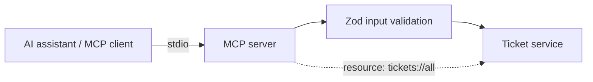

# mcp-server — a TypeScript Model Context Protocol server

> An **MCP server** that gives AI assistants a safe, standard way to use an
> internal service. It exposes a ticket domain as **tools** (with
> **Zod-validated inputs**) and a **resource**, served over stdio — plus a demo
> **MCP client** that drives it.


> ℹ️ An **original reference implementation**. No proprietary code or data.

---

## What it is

The [Model Context Protocol](https://modelcontextprotocol.io) lets AI assistants
call tools and read resources through one standard interface. This server puts
that boundary in front of an internal "tickets" service: the assistant can
list/search/create tickets and change their status, but every argument is
validated by a **Zod** schema before it touches the domain.



## Tools

| Tool | Input (Zod-validated) | Does |
| --- | --- | --- |
| `list_tickets` | — | list all tickets |
| `get_ticket` | `id` | fetch one (errors if missing) |
| `create_ticket` | `title`, `body`, `assignee?` | create a ticket |
| `search_tickets` | `query` | full-text search title/body |
| `set_ticket_status` | `id`, `status` | transition status |

Plus a `tickets://all` **resource** exposing the collection as JSON.

---

## Run it

```bash
npm install
npm start          # serve over stdio (for an MCP client / AI assistant)
npx tsx src/client.ts   # demo client: launches the server, lists tools, calls one
```

Point a real assistant at it by configuring an MCP server that runs
`npx tsx src/index.ts` (stdio transport).

## Tests

```bash
npm run typecheck   # tsc --noEmit
npm test            # vitest
```
Cover the ticket store (CRUD + search + status), the tool handlers (including
the not-found error), and the Zod schemas (accepts valid, rejects bad status /
empty fields). The domain and tool logic are framework-free, so they test
without spinning up a transport.

---

## Design decisions

- **Tools are thin wrappers over plain functions** — the service logic is
  unit-tested directly; the MCP layer only validates and serializes.
- **Zod at the boundary** — an assistant's arguments are untrusted input;
  schemas reject malformed calls before they reach internal code.
- **stdio transport** — the standard local-tool transport; the same server also
  fits Streamable HTTP without touching the tool definitions.

---

*An original reference implementation. No proprietary code or data is included.*
